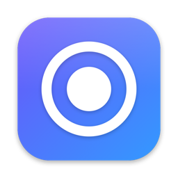

<div align="center">



# Framecast

**Beautiful screen recordings for macOS, with zero editing.**

Record your screen and Framecast turns it into a polished video: smooth zooms on your clicks,
a crisp animated cursor, a stylish background and an optional webcam bubble.

[](https://github.com/itsmrroot/framecast/releases/latest)
[](https://github.com/itsmrroot/framecast/actions/workflows/release.yml)


[**Download**](https://github.com/itsmrroot/framecast/releases/latest) · [Features](#-features) · [Build from source](#-build-from-source) · [Architecture](#-architecture)

</div>

---

## ✨ Highlights

- 🎯 **Automatic zoom.** Click clusters become smooth zooms, and the camera follows your cursor.
- 🖱️ **Cursor as data.** Position, clicks and cursor shape are recorded separately, so you can restyle the cursor after recording.
- 🎨 **Instant polish.** Wallpapers, gradients, padding, rounded corners and shadows, with no keyframes to set.
- 🔒 **Privacy built in.** Blur or pixelate passwords, emails and customer data. The blur follows every zoom.
- 💬 **Captions on your Mac.** Transcribe your narration on-device, edit the lines, burn them in or export `.srt`.
- ⌨️ **Keystrokes on screen.** Shortcuts like ⌘⇧S appear as clean pills, so viewers can follow along.
- 🐇 **Smart speed.** One click speeds up typing and idle moments, or cuts them out.
- 📸 **Webcam that does more.** Blur or remove your background, go full screen for intros and outros, or hide the camera for any part of the video.
- ⚡ **Native and fast.** Built with ScreenCaptureKit, AVFoundation and Core Image on Metal. The preview and the export use the same renderer, so what you see is what you get.

## 📥 Install

1. Download the installer for your Mac from the [**latest release**](https://github.com/itsmrroot/framecast/releases/latest):

   | Your Mac | File |
   | --- | --- |
   | Apple Silicon (M1 and later) | `Framecast-x.y.z-Apple-Silicon.dmg` |
   | Intel | `Framecast-x.y.z-Intel.dmg` |

   Not sure which you have? Open  → **About This Mac** and look at **Chip** or **Processor**.

2. Open the DMG and drag **Framecast** into **Applications**.
3. Releases are not notarized yet, so macOS will block the first launch. Right-click the app and choose **Open**, or run:

   ```bash
   xattr -dr com.apple.quarantine /Applications/Framecast.app
   ```

4. Allow **Screen & System Audio Recording** when asked, then quit and reopen Framecast. Camera and Microphone access are only requested if you turn them on.

Recordings are saved to `~/Movies/Framecast`. Framecast updates itself: it checks for new versions on launch, and **Framecast → Check for Updates…** checks right away.

## 🚀 Features

<details open>
<summary><b>🎬 Recording</b></summary>

- Record a full display, a single window (with a thumbnail picker), or a dragged area
- System audio, microphone and webcam, each saved to its own file and kept in sync
- 3 s or 5 s countdown, pause and resume, restart, cancel
- Floating control bar and menu bar timer, both hidden from the recording
- Global shortcut <kbd>⌘</kbd> <kbd>⇧</kbd> <kbd>2</kbd> to start or stop from anywhere
- Option to hide desktop icons
- Optional keystroke recording. macOS never passes on keys typed into password fields.
- One-click access to the system's Voice Isolation mic mode
- 30 or 60 fps HEVC capture at native Retina resolution

</details>

<details open>
<summary><b>✂️ Editor</b></summary>

- **Zoom:** generated automatically from click clusters with smooth log-space easing. Add your own by clicking the zoom lane, then drag to move or resize it. Set the zoom level, and choose whether it follows the cursor or stays on a fixed point.
- **Camera:** follows the cursor using a dead zone and spring damping
- **Cursor:** smoothing, size, high-res vector arrow, motion blur, ripple or ring click effects, a press animation, hide when idle
- **Background:** macOS wallpapers, 16 gradients, solid colours or your own image, with optional blur
- **Frame:** padding, rounded corners, shadow strength and softness
- **Aspect ratio:** Auto, 16:9, 4:3, 5:4, 1:1, 4:5, 9:16, 3:4
- **Webcam:** circle, rounded or square shape, four positions, size, mirror, border
- **Timeline:** filmstrip, split, cut, trim by dragging clip edges, per-clip speed from 0.5× to 8× with pitch preserved
- **Effects lane:** add blur, spotlight, title, hide-cursor and camera-layout effects. They can overlap, so you can blur several areas at once. Draw each area on a frame of the recording.
- **Captions:** on-device transcription in any language macOS supports, with editable lines, adjustable size and SRT export
- **Keystrokes:** show shortcuts only or everything you type, at any size
- **Smart speed:** speed up idle moments (4× or 8×) or typing (2× or 4×), cut idle moments, or reset all speeds
- **Camera background:** keep it, blur it, or remove it (Vision person segmentation)
- **Audio:** separate volume for system audio and microphone
- Undo and redo, style presets, a default style for new recordings
- Import existing videos and edit them the same way

</details>

<details open>
<summary><b>📤 Export</b></summary>

- MP4 in H.264 or HEVC: 720p, 1080p, 1440p or 4K, at 24, 30 or 60 fps, with three quality levels
- Animated GIF
- Save any frame as a PNG
- Captions as `.srt`
- Show in Finder, open, or copy to the clipboard and paste straight into Slack, Mail and similar apps

</details>

## ⌨️ Editor shortcuts

| Key | Action |
| --- | --- |
| <kbd>Space</kbd> | Play / pause |
| <kbd>S</kbd> | Split clip at playhead |
| <kbd>Z</kbd> | Add zoom at playhead |
| <kbd>B</kbd> | Add blur at playhead |
| <kbd>T</kbd> | Add title at playhead |
| <kbd>⌫</kbd> | Delete selected zoom, or cut selected clip |
| <kbd>←</kbd> <kbd>→</kbd> | Step one frame |
| <kbd>⌘</kbd> <kbd>Z</kbd> / <kbd>⇧</kbd> <kbd>⌘</kbd> <kbd>Z</kbd> | Undo / redo |
| <kbd>⌘</kbd> <kbd>E</kbd> | Export |

## 🛠 Build from source

Requires macOS 15 or later and Xcode (or the Command Line Tools).

```bash
git clone https://github.com/itsmrroot/framecast.git
cd framecast
scripts/build-app.sh            # builds build/Framecast.app (release)
open build/Framecast.app
```

| Option | Example |
| --- | --- |
| Debug build | `scripts/build-app.sh debug` |
| Build for a specific chip | `ARCH=x86_64 scripts/build-app.sh` |
| Sign with a specific identity | `CODESIGN_IDENTITY="Apple Development: …" scripts/build-app.sh` |
| DMG installer (after building) | `pip install dmgbuild && scripts/make-dmg.sh Framecast.dmg` |

The script signs with your Apple Development identity when one is installed, so macOS keeps your privacy permissions between rebuilds.

> [!NOTE]
> Without full Xcode installed, the script builds against the macOS 26 SDK from the Command Line Tools. SwiftUI in the macOS 27 SDK needs Xcode's macro plugins.

### Releasing

Push a version tag. GitHub Actions builds the app for Apple Silicon and Intel and publishes a DMG installer for each (plus the zips the in-app updater uses) to a new release:

```bash
git tag v1.0.0 && git push origin v1.0.0
```

## 🧱 Architecture

```
Sources/Framecast/
├── App/        App entry, window management, menu bar, headless self-tests
├── Recording/  ScreenCaptureKit capture, camera/mic capture, cursor recorder,
│               shared RecordingClock (aligns every stream at t=0, removes pauses),
│               countdown / area selection / control bar overlays, global hotkey
├── Project/    Codable project model, library, presets, Transcriber (Speech),
│               EditMap (source ↔ edited time), auto-zoom generator, smart speed
├── Render/     CursorPath (spring-smoothed), CameraPath (zoom + follow),
│               RenderModel (immutable render snapshot), FrameRenderer (Core Image),
│               TextArt (captions, keystrokes, titles), PersonSegmenter (Vision),
│               AVFoundation custom video compositor + composition builder
├── Export/     MP4 (AVAssetReader → AVAssetWriter) and GIF export
└── UI/         SwiftUI home screen, editor, timeline, inspector, export sheet
```

- **One renderer.** The same custom `AVVideoCompositing` compositor drives the live preview (through `AVPlayer`) and the export.
- **Non-destructive edits.** Cuts and speed changes are applied with an `AVMutableComposition`. Zooms, cursor effects and styling are drawn per frame by `FrameRenderer` in output pixels, so they stay sharp at any zoom level.
- **Simple projects.** A project is a `*.framecast` folder containing `screen.mov`, `webcam.mov`, `mic.m4a`, `cursor.json`, `keys.json`, the cursor images, and `project.json` with the edits, effects, captions and style.

## 🧪 Self-tests

```bash
# Render pipeline: builds a project from any video with simulated cursor and clicks, exports MP4 + GIF
build/Framecast.app/Contents/MacOS/Framecast --selftest <video.mov> <outDir>

# Capture pipeline: records the main display for N seconds (with a pause), then exports
build/Framecast.app/Contents/MacOS/Framecast --recordtest 3 <outDir>

# Open a project folder directly in the editor
open build/Framecast.app --args --open <folder.framecast>
```

---

<div align="center">
<sub>Inspired by Screen Studio · Made with Swift for macOS</sub>
</div>
